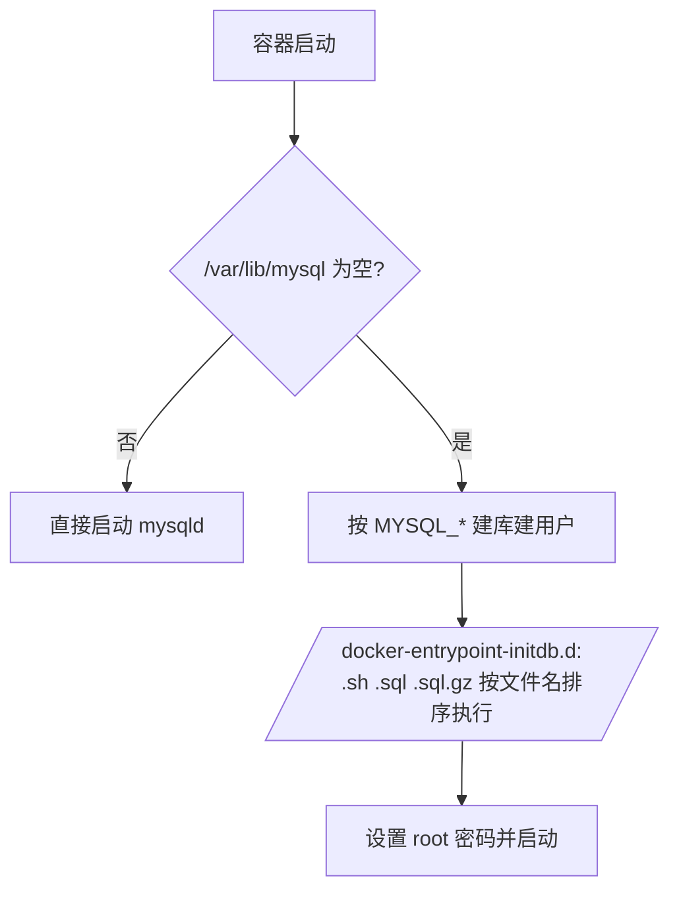

# Docker 使用 MySQL 指南

## 0. Arch 上装 Docker

```bash
sudo pacman -S --needed docker docker-compose
sudo systemctl enable --now docker
sudo usermod -aG docker "$USER"   # 重新登录生效
docker info | grep -E 'Server Version|Storage Driver'
```

## 1. 选镜像

| tag | 说明 | 用途 |
|---|---|---|
| `mysql:8.4` | LTS，长期支持 | **生产默认** |
| `mysql:9` | innovation，季度发版 | 尝鲜/对齐新特性 |
| `mysql:8.0` | 老线，已停止更新支持 | 仅兼容存量系统 |

镜像基于 Oracle Linux，`mysql` 用户 UID/GID = **999**，数据目录 `/var/lib/mysql`，socket `/var/run/mysqld/mysqld.sock`。

## 2. 最小可用

```bash
docker run -d --name mysql \
  -e MYSQL_ROOT_PASSWORD='S3cret!' \
  -e MYSQL_DATABASE=appdb \
  -e MYSQL_USER=app \
  -e MYSQL_PASSWORD='AppPass!' \
  -p 127.0.0.1:3306:3306 \
  -v mysql_data:/var/lib/mysql \
  --restart unless-stopped \
  mysql:8.4
```

```bash
docker logs -f mysql                      # 看 "ready for connections"
docker exec -it mysql mysql -uroot -p     # 容器内登录
```

从宿主机连（需要客户端：`sudo pacman -S mariadb-clients`）：

```bash
mysql -h 127.0.0.1 -P 3306 -uapp -p appdb
```

## 3. 环境变量（只在首次初始化生效）

| 变量 | 作用 |
|---|---|
| `MYSQL_ROOT_PASSWORD` | root 密码（必需，除非用随机/空密码） |
| `MYSQL_DATABASE` | 建库，默认 `utf8mb4` |
| `MYSQL_USER` / `MYSQL_PASSWORD` | 建普通用户（host 为 `%`），并授予该库全部权限 |
| `MYSQL_ROOT_HOST` | 允许 root 从哪些 host 登录，默认仅 `localhost`；跨容器用 root 才需要 `%` |
| `MYSQL_ALLOW_EMPTY_PASSWORD=yes` | 空密码，仅本地实验 |
| `MYSQL_RANDOM_ROOT_PASSWORD=yes` | 随机密码，见 `docker logs mysql` |

**幂等性**：这些变量只在 `/var/lib/mysql` 为空时执行。改密码请进库 `ALTER USER`，改环境变量无效。

## 4. 推荐方式：docker compose

```yaml
# compose.yaml
services:
  mysql:
    image: mysql:8.4
    container_name: mysql
    restart: unless-stopped
    environment:
      MYSQL_ROOT_PASSWORD: ${MYSQL_ROOT_PASSWORD:?在 .env 里设置}
      MYSQL_DATABASE: appdb
      MYSQL_USER: app
      MYSQL_PASSWORD: ${MYSQL_PASSWORD:?在 .env 里设置}
      TZ: Asia/Shanghai
    ports:
      - "127.0.0.1:3306:3306"        # 只暴露给本机
    volumes:
      - mysql_data:/var/lib/mysql
      - ./conf.d:/etc/mysql/conf.d:ro
      - ./initdb:/docker-entrypoint-initdb.d:ro
    command:
      - --character-set-server=utf8mb4
      - --collation-server=utf8mb4_0900_ai_ci
      - --default-time-zone=+08:00
    healthcheck:
      test: ["CMD", "mysqladmin", "ping", "-h", "127.0.0.1", "-uroot", "-p$$MYSQL_ROOT_PASSWORD"]
      interval: 10s
      timeout: 5s
      retries: 10
      start_period: 30s

volumes:
  mysql_data:
```

```bash
mkdir -p conf.d initdb
printf 'MYSQL_ROOT_PASSWORD=xxx\nMYSQL_PASSWORD=yyy\n' > .env
docker compose up -d
docker compose ps          # 等 healthy
docker compose logs -f mysql
```

> `$$` 是 compose 的转义，交给容器内 shell 展开；不要写成 `$MYSQL_ROOT_PASSWORD`。
> `mysqladmin ping` 只证明进程活着，认证失败也可能返回 0。

## 5. 初始化流程



`initdb` 里放建表/种子数据，只在**首次**执行；要重跑必须清空数据目录（`docker compose down -v`，数据全丢）。

## 6. 配置

挂载 `./conf.d/my.cnf`（镜像会 `!include /etc/mysql/conf.d/*.cnf`）：

```ini
[mysqld]
innodb_buffer_pool_size = 1G     # 容器内存的 50–70%，超过容器限制会 OOM
max_connections = 200
skip-name-resolve
bind-address = 0.0.0.0            # 容器内必须监听 0.0.0.0，外部暴露靠 -p 127.0.0.1
slow_query_log = 1
long_query_time = 1
```

显式 `utf8mb4` 不必写（8.0+ 默认），但客户端/连接串最好统一声明。字符集和排序规则通过 `command` 传入也只在首次初始化生效——**已有数据目录要以配置文件为准**。

## 7. 备份 / 恢复

```bash
# 备份（单事务，不锁业务表）
docker exec mysql sh -c 'exec mysqldump --single-transaction --routines --triggers --events \
  -uroot -p"$MYSQL_ROOT_PASSWORD" appdb' > appdb-$(date +%F).sql

# 恢复
docker exec -i mysql sh -c 'exec mysql -uroot -p"$MYSQL_ROOT_PASSWORD" appdb' < appdb-2026-11-07.sql

# 全库
docker exec mysql sh -c 'exec mysqldump --single-transaction --all-databases -uroot -p"$MYSQL_ROOT_PASSWORD"' > all.sql
```

## 8. 跨版本升级：dump → 新容器 → restore

官方**不支持**直接把数据目录给更高大版本用（8.0 → 8.4 → 9 都不行）。步骤：

```bash
# 1) 旧容器全量导出
docker exec mysql sh -c 'exec mysqldump --single-transaction --routines --triggers --events \
  --all-databases -uroot -p"$MYSQL_ROOT_PASSWORD"' > all.sql
# 2) 改镜像 tag，用全新卷启动新容器
docker compose down && docker volume rm mysql_data   # 或改用新卷名
# 3) 导入
docker exec -i mysql sh -c 'exec mysql -uroot -p"$MYSQL_ROOT_PASSWORD"' < all.sql
```

认证插件坑：`mysql_native_password` 在 8.4 默认禁用、9.x 已移除。老客户端连 9.x 会报 `Plugin ... could not be loaded`，要么升级客户端（支持 `caching_sha2_password`），要么留在 8.4 并把用户显式改为 `caching_sha2_password`。

## 9. 常见坑

| 现象 | 原因 / 处理 |
|---|---|
| `mysqld: Can't create/write to file` | bind mount 目录属主不对：`sudo chown -R 999:999 ./data`，或改用命名卷 |
| 改了 `MYSQL_PASSWORD` 没生效 | 变量只在空数据目录时生效，进库 `ALTER USER 'app'@'%' IDENTIFIED BY ...` |
| 宿主机连不上，容器内正常 | 端口只发布到 `127.0.0.1`；要对外用 SSH 隧道，别直接改 `-p 3306:3306` |
| 其它容器连 `127.0.0.1:3306` 失败 | 容器间用 compose 服务名：`mysql:3306`，用户 `'app'@'%'` |
| `Access denied for user 'root'@'...'` 跨容器 | 首启加 `MYSQL_ROOT_HOST=%`，或干脆用业务账号 |
| 初始化脚本没跑 | 数据目录非空；`docker compose down -v` 后重来（会删数据） |
| 容器反复重启 / OOM | buffer pool 大于容器内存限制，调小或放宽 `--memory` |
| 时区差 8 小时 | 同时设 `TZ` 与 `--default-time-zone=+08:00` |

## 10. 清理

```bash
docker compose down            # 停容器，保留数据卷
docker compose down -v         # 连数据一起删，不可恢复
docker image prune -f
```

## 附：`docker pull` 是什么

从镜像仓库（默认 Docker Hub）把镜像**下载到本地**，只下载，不创建也不启动容器。

```bash
docker pull mysql:8.4        # 拉某个 tag
docker pull mysql            # 等价 mysql:latest
docker pull mysql@sha256:... # 按 digest 拉，内容不可变，适合固定版本
```

名字解析为 `[registry/]namespace/repo[:tag]`，默认 `docker.io/library/mysql:8.4`；先取 manifest（tag → 各架构 digest），再按层比对本地缓存，只下载缺的层：

```
8.4: Pulling from library/mysql
a1b2c3d4: Already exists      # 层已在本地
e5f6g7h8: Pull complete       # 本次下载
Digest: sha256:9f...          # 该 tag 当前指向的镜像摘要
Status: Downloaded newer image for mysql:8.4
```

`docker run` 发现本地没有镜像会**自动 pull**；`docker pull` 只是提前拉，适合预热和离线部署。

```bash
docker images                 # 本地镜像（tag、大小、ID）
docker rmi mysql:9            # 删镜像（被容器引用会拒绝，先 docker rm）
docker image prune            # 清理悬空镜像
docker pull --platform linux/amd64 mysql:8.4   # 指定架构
```

tag 可变：`mysql:8.4` 会被上游重推，要可复现就锁 digest 或具体小版本（`mysql:8.4.5`）。国内拉不动时配 `/etc/docker/daemon.json` 的 `registry-mirrors` 后重启 docker，或用代理前缀 `docker.m.daocloud.io/library/mysql:8.4`。
